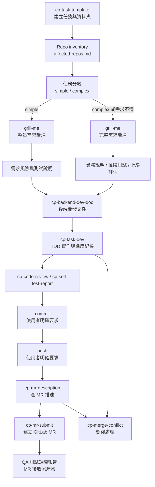

# CP 後端工作流 Skills（work-flow-skill-sean）

一套把 CP 專案後端從「建禪道任務」到「合併結案」串起來的 Claude Code skills，並提供 `cp-backend-workflow` 作為總控入口。
每個 skill 各管一個階段，coding 可由 `cp-task-dev` 協助以 TDD 實作並留下開發紀錄，其餘產文件 / review / 描述的重複工由 skill 代勞。

## 目錄

- `skills/` — 各階段 skill（安裝到 `~/.codex/skills/` 或 `~/.claude/skills/` 使用，此處為 source）
- `cp-task-folder-template/` — 任務資料夾範本

本 repo 自帶 `skills/grill-me/`，供 `cp-backend-workflow` 在任務分級後進行需求釐清；simple 任務使用輕量 grill，complex 任務使用完整 grill，不需要依賴外部 `grilling` skill 或個人 symlink。

## 前置需求

- 使用 `/cp-task-template` 從禪道任務 URL 自動讀取內容時，需先安裝並啟用 Chrome 瀏覽器 MCP 套件／擴充功能，讓工作階段可使用 `tabs_context_mcp`、`navigate` 與 `get_page_text`／`read_page`。若沒有此套件或尚未登入禪道，直接貼上任務內容即可繼續產生模板。

## 完整流程

完整任務可使用總控入口：

```text
/cp-backend-workflow CP-{編號}
```



1. `cp-task-template`：建立禪道主任務、前／後端子任務與任務資料夾。
2. Repo inventory：建立 `project-doc/affected-repos.md`，確認實際受影響的 repo。
3. 任務分級與需求釐清：判斷 `simple` / `complex`，並使用 `grill-me` 逐題確認；simple 使用輕量 grill，complex 使用完整 grill。
4. 會議前置文件：產出業務說明、需求風險與測試說明、上線評估。
5. `cp-backend-dev-doc`：探索 codebase，產生後端開發文件 HTML／Markdown。
6. `cp-task-dev`：需求分析、TDD 測試計畫、Red → Green → Refactor、開發進度紀錄。
7. `cp-code-review`：需要時進行提測前 review。
8. `cp-self-test-report`：需要時產生後端自測報告。
9. `commit`：使用者明確要求後執行 commit。
10. `push`：使用者明確要求後執行 push。
11. `cp-mr-description`：產生每個 repo 的 MR 描述。
12. `cp-mr-submit`：使用者確認後建立 GitLab MR。
13. QA 測試矩陣報告：MR 建立後，依最終需求、MR、自測與上線評估產生交付 QA 的測試矩陣。
14. `cp-merge-conflict`：發生合併衝突時分析並等待使用者確認後修改。

其中 review 和自測報告是可依任務需求啟用的階段；coding 完成後，必須先完成需要的驗證，再進入 commit、push 與 MR 流程。

## 任務文件與續跑

每個任務的文件路徑固定為：

```text
task-doc/{禪道衝刺版號}/task-{任務編號}/
├── project-doc/
│   ├── requirement-analysis.md
│   ├── affected-repos.md
│   ├── business-brief.md
│   ├── requirement-risk-test-brief.md
│   ├── release-assessment.md
│   └── backend-dev-doc.md
├── test-file-script/
│   └── tdd-test-plan.md
├── handoff/
│   ├── workflow-state.md
│   ├── requirement-changes.md
│   └── dev-progress.md
└── end-version-report/
    ├── mr-description/
    ├── qa-test-matrix/
    └── release-assessment/
```

`simple` 任務至少維護 `requirement-risk-test-brief.md`；`complex` 任務額外維護 `business-brief.md` 與 `release-assessment.md`。涉及 DB / Redis / 預發正式共用資源時，預設為 `complex`。QA 測試矩陣報告是 MR 建立後的收尾產物，放在 `end-version-report/qa-test-matrix/`。

跨 session 續跑時，先讀取：

```text
workflow-state.md
requirement-changes.md
affected-repos.md
business-brief.md
requirement-risk-test-brief.md
release-assessment.md
dev-progress.md
```

總控會從第一個 `pending`、`blocked` 或 `needs_update` 的階段繼續，不重做已完成階段。需求變更時，追加新的 `R1`、`R2`、`R3` 版本，並只將受影響的文件與 repo 標記為 `needs_update`。

## 外部操作邊界

- Agent 可以修改程式、測試與任務文件。
- `git commit`、`git push`、建立或修改 GitLab MR，都需要使用者明確要求。
- 不同 repo 分開處理，不混在同一個 commit 或 MR。
- 後續 review、commit、push、MR 都以 `affected-repos.md` 的範圍為準。

## 使用說明

### 一、完整任務流程

如果要從需求一路處理到 MR，直接使用：

```text
/cp-backend-workflow CP-5987
```

啟動時準備以下資訊：

- CP／禪道任務編號，以及任務 URL 或完整內容。
- 禪道 Scrum sprint version，例如 `1_25_0`。
- 受影響的後端 repo；如果不確定，讓 skill 先探索 codebase。
- 是否需要自測報告、commit、push、MR 描述或建立 MR。
- 實作方式：由 Agent 以 TDD 協助，或由使用者自行 coding。

任務文件會放在：

```text
task-doc/{衝刺版號}/task-{編號}/
```

總控會依照目前文件與 repo 狀態續跑，不會重做已完成階段。若需求中途變更，會先記錄新的需求版本，再判斷哪些文件或 repo 需要返工。

### 二、只使用 TDD 開發 skill

如果任務模板與後端開發文件已經存在，只想開始實作，可以直接說：

```text
請使用 cp-task-dev 開始實作 CP-5987。
任務目錄：task-doc/1_25_0/task-5987
請先讀取既有 workflow-state、requirement-changes、affected-repos、會議前置文件與後端開發文件，
先完成需求分析和 TDD 測試計畫，再開始 Red / Green / Refactor。
```

也可以明確指定人工 coding：

```text
我會自行 coding，請用 cp-task-dev 幫我建立需求分析、TDD 測試計畫，並在我每次回報後更新 dev-progress。
任務目錄：task-doc/1_25_0/task-5987
```

### 三、cp-task-dev 會做什麼

它會依序：

1. 讀取既有狀態與開發文件，確認任務、版本、路徑和受影響 repo。
2. 整理驗收條件、API、DB、權限、錯誤處理、相容性與不在範圍內的項目。
3. 建立測試案例，涵蓋成功流程、輸入／權限／資料異常與回歸風險。
4. 先執行 Red，再做最小 Green 實作，最後進行 Refactor 與回歸測試。
5. 將測試命令、結果、變更檔案、阻塞和下一步寫入交接文件。

固定產出：

```text
project-doc/requirement-analysis.md
test-file-script/tdd-test-plan.md
handoff/dev-progress.md
```

### 四、跨 session 續跑

下次接續同一個任務時，直接提供任務目錄並說明「續跑」即可：

```text
請續跑 task-doc/1_25_0/task-5987，先讀取 workflow-state.md、requirement-changes.md、affected-repos.md、會議前置文件和 dev-progress.md，
從第一個 pending、blocked 或 needs_update 的階段繼續。
```

既有文件必須先讀取並追加，不能覆蓋歷史紀錄；未執行的測試不能標記為通過。

### 五、外部操作邊界

`cp-task-dev` 可以協助修改程式、測試和任務文件，但不會自行執行：

- `git commit`
- `git push`
- 建立或修改 GitLab MR

完成 coding 後，可再依序要求 `cp-code-review`、`commit`、`cp-self-test-report`、`cp-mr-description` 或 `cp-mr-submit`。

### 六、安裝與同步

本 repository 的 `skills/` 是 source。修改 skill 後，需同步到 Codex 或 Claude runtime。

```bash
scripts/install-codex.sh
scripts/install-claude.sh
```

移除本 repository 管理的 skills：

```bash
scripts/uninstall-codex.sh
scripts/uninstall-claude.sh
```

安裝與移除都支援先預覽：

```bash
scripts/install-codex.sh --dry-run
scripts/uninstall-codex.sh --dry-run
```

同步後，下一個 Codex / Claude session 即可使用最新版本。

## Skills 一覽

| 階段 | Skill | 用途 | 產出 |
|---|---|---|---|
| 1 建需求 | **cp-task-template** | 問放哪 → 用 `cp-task-folder-template` 建 task 資料夾，再產禪道任務模板 | `task-{編號}/` 資料夾 + 主任務 + 前/後端子任務 HTML |
| 2 開發文件 | **cp-backend-dev-doc** | 探索 java-service，起草後端設計 | dev-doc `.html`（貼禪道）+ `.md`（開發者看） |
| 3 TDD coding | **cp-task-dev** | 需求分析、TDD 測試計畫、實作與開發交接紀錄 | `project-doc/requirement-analysis.md`、`test-file-script/tdd-test-plan.md`、`handoff/dev-progress.md` |
| — commit | **commit** | 繁中 Conventional Commit（全域 skill，非本專案） | git commit |
| 4 自測報告 | **cp-self-test-report** | 依主管官方模板產自測報告 | 四段式 HTML（功能場景 / DB 核對 / 單元測試 / 其他） |
| 5 提測 review | **cp-code-review** | 提測前自我 review diff，或 review 別人 MR | review 意見 |
| 6 結案寫描述 | **cp-mr-description** | 產 GitLab MR 描述 | MR 描述 Markdown |
| 7 提交 MR | **cp-mr-submit** | 透過 Chrome 建立 GitLab MR、設定 Assignee 與 merge options | MR URL 清單 |
| 8 合併衝突 | **cp-merge-conflict** | 半自動：分析兩側改動給建議，人確認才寫入 | 合併建議 |

| 輔助 | **grill-me** | 逐題釐清任務需求、風險、測試與上線決策；simple 輕量、complex 完整 | 確認後供業務說明、風險測試說明、上線評估更新 |
| 總控 | **cp-backend-workflow** | 判斷目前階段並協調各子 skill，管理多 repo 進度 | 完整流程狀態與 MR URL |

## 設計原則

- **coding 可協助但不越界**：`cp-task-dev` 可協助 TDD 實作與紀錄；commit、push、MR 等外部狀態操作仍需使用者明確要求。
- **合併衝突人工優先**：cp-merge-conflict 只給分析與建議，人是最後手段。
- **source 與安裝同步**：改 `~/.claude/skills/` 後要 copy 回本 repo `skills/`，避免 source 落後。
