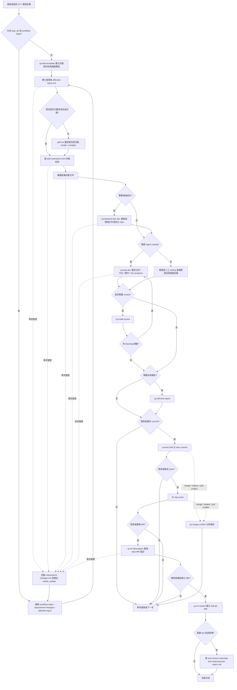

# CP Backend 工作流程

> 本文件記錄目前 CP 後端任務從禪道需求到 MR / QA 交付的標準工作流程。實際執行以 `cp-backend-workflow` 作為總控入口，各階段由對應 skill 處理。

---

## 工作流程總覽

完整任務入口：

```text
/cp-backend-workflow CP-{編號}
```

標準流程：



```text
1. 建立任務模板
   └── cp-task-template：建立 task 資料夾、禪道主任務、前 / 後端子任務 HTML

2. Repo inventory
   └── 總控建立 project-doc/affected-repos.md，後續 review / commit / push / MR 皆以此為準

3. 任務分級與需求釐清
   └── simple / complex 分級，使用 grill-me 釐清改動範圍、驗收條件、風險、測試與上線決策

4. 任務估時
   └── 依任務分級、affected repos、風險與待確認事項產出 task-estimation.html

5. 會議前置文件
   └── simple：開發前主管提報文件
   └── complex：另補詳細業務流程；有上線風險時補上線評估

6. 後端開發文件
   └── cp-backend-dev-doc：探索 codebase，產生 backend dev doc Markdown / HTML

7. TDD 實作與交接紀錄
   └── cp-task-dev：需求分析、TDD 測試計畫、Red -> Green -> Refactor、dev-progress

8. Review / 自測報告
   └── cp-code-review：提測前 self-review 或 MR review
   └── cp-self-test-report：需要時產生後端自測報告

9. Commit / Push
   └── commit、push 都必須由使用者明確要求；多 repo 分開處理

10. MR 描述與提交
   └── cp-mr-description：每個 repo 產 MR Markdown
   └── cp-mr-submit：使用者確認後建立 GitLab MR

11. QA 測試矩陣報告
    └── MR 建立後，依最終需求、MR、自測與上線評估產出 QA 測試矩陣

12. 合併衝突
    └── cp-merge-conflict：分析兩側改動並提出方案，等待使用者確認後才寫入
```

其中 review、自測報告、MR 提交與 QA 測試矩陣可依任務需要啟用；coding 完成後必須先完成需要的驗證，再進入 commit、push 與 MR。

### 流程步驟與 Skill 對照

| 步驟 | 主 skill | 可引用的輔助 skill | 觸發條件 | 主要產物 / 動作 |
|---|---|---|---|---|
| 1. 建立任務模板 | `cp-task-template` | `cp-backend-workflow` | 沒有任務資料夾、禪道任務描述需要建立或更新 | 任務資料夾、禪道主任務 HTML、前 / 後端子任務 HTML |
| 2. Repo inventory | `cp-backend-workflow` | `cp-backend-dev-doc` 探索結果 | 沒有 `affected-repos.md`、需求變更、後端設計發現新 repo | `project-doc/affected-repos.md` |
| 3. 任務分級與需求釐清 | `cp-backend-workflow` | `grill-me`、`karpathy-guidelines` | 需求未釐清、任務需分 simple / complex、存在假設或高風險業務行為 | simple / complex 判斷、待確認問題、確認結論 |
| 4. 任務估時 | `cp-backend-workflow` | `grill-me` 結論、`affected-repos.md`、`karpathy-guidelines` | 任務分級與主要範圍完成後；需求變更影響範圍、風險或驗收時 | `project-doc/task-estimation.html` |
| 5. 會議前置文件 | `cp-backend-workflow` | `grill-me` 結論、`karpathy-guidelines` | 分級完成後；開發前需要提報主管或會議前需要明確風險與測試範圍 | `pre-dev-brief.html`；complex 另產 `business-brief.html`；有上線風險時產 `release-assessment.html` |
| 6. 後端開發文件 | `cp-backend-dev-doc` | `karpathy-guidelines`、`cp-backend-workflow` 校正 repo | 需求需要 API / DB / Redis / 業務流程設計，或既有設計需更新 | backend dev doc Markdown / HTML、校正 affected repos |
| 7. TDD 實作與交接紀錄 | `cp-task-dev` | `karpathy-guidelines`、必要時 `grill-me` | 使用者要 Agent coding、需要 TDD、需求仍有實作前歧義 | `requirement-analysis.md`、`tdd-test-plan.md`、`dev-progress.md`、程式 / 測試改動 |
| 8. Code Review | `cp-code-review` | `karpathy-guidelines`、`cp-task-dev` 測試紀錄 | 使用者要求 review、提測前、MR review、commit 前需要風險確認 | blocking / non-blocking / OK review 結果 |
| 9. 自測報告 | `cp-self-test-report` | `cp-task-dev` 測試紀錄、`cp-code-review` 結果 | 使用者要求自測報告、任務明確需要後端自測交付 | 後端自測報告 HTML |
| 10. Commit | `commit` | `cp-backend-workflow`、`cp-code-review` | 使用者明確要求 commit，且 repo 範圍與測試 / review 狀態已確認 | 每個 repo 各自 commit |
| 11. Push | 無專用 skill，由總控執行 | `cp-backend-workflow` | 使用者明確要求 push，且每個 repo 已 commit | 每個 repo 各自 push |
| 12. MR 描述 | `cp-mr-description` | `affected-repos.md`、`cp-task-dev`、`cp-self-test-report`、`cp-code-review` | 使用者要開 MR 或產 MR 描述，且 repo 範圍已確認 | `end-version-report/mr-description/` |
| 13. MR 提交 | `cp-mr-submit` | Chrome / GitLab 登入狀態、`cp-mr-description` | 使用者確認 MR 描述並要求建立 MR | GitLab MR URL |
| 14. QA 測試矩陣報告 | `cp-backend-workflow` | `cp-task-dev`、`cp-self-test-report`、`cp-mr-description` | MR 建立後，使用者需要交付 QA 測試範圍 | `end-version-report/qa-test-matrix/qa-test-matrix.md` |
| 15. 合併衝突 | `cp-merge-conflict` | `cp-backend-workflow` 暫停後續階段 | 發生 conflict 時跑 | 衝突分析、合併建議、確認後寫入 |

輔助 skill 調用規則：

- `karpathy-guidelines` 是品質閘門，不是獨立階段；需求釐清、後端設計、TDD、review 都要套用。
- `grill-me` 只負責逐題釐清決策，不直接改文件；結論由總控寫入業務、風險、測試或上線文件。
- `cp-task-dev` 的測試紀錄是 review、自測報告、MR 描述與 QA 測試矩陣的主要輸入之一。
- `cp-code-review` 的結果可回饋到 `cp-task-dev` 修正，也可作為 commit / MR 前的風險依據。
- `cp-backend-dev-doc` 完成後必須回饋 `affected-repos.md`，避免後續 review / commit / MR 範圍過期。

---

## 任務文件結構

每個任務先確認任務文件根目錄 `task_root`，再建立完整任務目錄 `task_dir`。預設可建議 `task-doc/{禪道衝刺版號}/`，但不得未經確認直接建立。

一般結構：

```text
{task_root}/task-{任務編號}/
├── project-doc/
│   ├── requirement-analysis.md
│   ├── affected-repos.md
│   ├── task-estimation.html
│   ├── pre-dev-brief.html
│   ├── business-brief.html
│   ├── release-assessment.html
│   └── backend-dev-doc.md
├── test-file-script/
│   └── tdd-test-plan.md
├── handoff/
│   ├── workflow-state.md
│   ├── requirement-changes.md
│   └── dev-progress.md
└── end-version-report/
    ├── mr-description/
    ├── qa-test-matrix/
    └── release-assessment/
```

續跑同一任務時，先讀取：

```text
workflow-state.md
requirement-changes.md
affected-repos.md
task-estimation.html
pre-dev-brief.html
business-brief.html
release-assessment.html
dev-progress.md
```

總控從第一個 `needs_update`、`blocked` 或 `pending` 的階段繼續，不重做已完成階段。需求變更時，追加 `R1`、`R2`、`R3` 版本，只將受影響文件與 repo 標記為 `needs_update`。

---

## Step 1：建立禪道任務模板

使用 `cp-task-template`：

- 先確認禪道衝刺版號、`task_root` 與 `task_dir`；預設路徑只能作建議，不能未確認就建立。
- 使用 `references/task-folder-template` 建立 `{task_dir}` 任務資料夾。
- 產出禪道主任務 HTML。
- 產出後端子任務 HTML。
- 產出前端子任務 HTML。

若要從禪道 URL 自動讀取內容，需有可用的 Chrome / Browser MCP 且已登入禪道；否則直接貼任務內容。

---

## Step 2：Repo Inventory

總控維護 `project-doc/affected-repos.md`，格式固定：

```markdown
# task-{編號} affected repos

| repo | 類型 | 路徑 | source branch | target branch | 狀態 | 備註 |
|---|---|---|---|---|---|---|
|  | backend / backend-base / backend-open / frontend / other |  |  | master | needs_confirm |  |
```

規則：

- 不確定是否受影響的 repo，保留並標記 `needs_confirm`。
- 明確相關但不需要改的 repo，標記 `not_required`。
- 多 repo 任務每個 repo 獨立一列。
- review、commit、push、MR 都以 `affected-repos.md` 為範圍，不重新猜。

---

## Step 3：任務分級與需求釐清

先判斷 `simple` / `complex`：

- `complex`：跨多 repo、影響 DB / Redis / MQ / 排程 / 回調 / 通知 / 資料修復、涉及資金 / 訂單 / 商戶 / 交易員 / 權限 / 風控 / 狀態機，或需要 PM / 後端 / 前端 / QA 會議對齊。
- `simple`：單 repo 小改、小 API、文案、查詢欄位，且無高風險外部依賴。

所有任務在後端開發文件前都要用 `grill-me` 釐清：

- simple：輕量確認改動範圍、驗收條件、主要風險、測試重點與不做事項。
- complex：完整確認業務流程、角色影響、DB / Redis / MQ / 排程 / 回調 / 通知、權限 / 風控、測試範圍、上線與回滾。

使用者明確說不用追問時可跳過，但必須在 `workflow-state.md` 記錄原因，並在文件中標示未確認假設。

---

## Step 4：任務估時

任務估時產出位置：

```text
project-doc/task-estimation.html
```

估時先用簡單 HTML 表格，固定欄位為：估時項目、工作內容、預估工時、備註。

備註：目前這份估時表是暫時給 CP 後端流程使用；之後再抽象成更通用的估時模型，並依不同系統、環境與交付流程定義不同的估時項目。

固定估時項目：

```html
<table>
  <thead>
    <tr>
      <th>估時項目</th>
      <th>工作內容</th>
      <th>預估工時</th>
      <th>備註</th>
    </tr>
  </thead>
  <tbody>
    <tr><td>需求整理</td><td></td><td></td><td></td></tr>
    <tr><td>Coding</td><td></td><td></td><td></td></tr>
    <tr><td>自測與修改</td><td></td><td></td><td></td></tr>
    <tr><td>文件整理</td><td></td><td></td><td></td></tr>
    <tr><td>前端對接文件</td><td></td><td></td><td></td></tr>
    <tr><td>Code Review / MR 準備</td><td></td><td></td><td></td></tr>
    <tr><td>部署收尾</td><td></td><td></td><td></td></tr>
    <tr><td>合計</td><td></td><td></td><td></td></tr>
  </tbody>
</table>
```

`Code Review / MR 準備` 是總控預設補上的估時項，包含 self-review、處理 review 問題與 MR 前置整理。

需求變更影響 repo 範圍、實作策略、驗收條件或風險時，`task-estimation.html` 標記 `needs_update`，更新時只調整受影響列與合計。

---

## Step 5：會議前置文件

simple 任務至少維護：

- `project-doc/task-estimation.html`
- `project-doc/pre-dev-brief.html`

complex 任務額外維護：

- `project-doc/business-brief.html`

涉及 DB、Redis、MQ、排程、回調、正式資料修復、預發正式差異或需要明確上線 / 回滾計畫時，額外維護：

- `project-doc/release-assessment.html`

`pre-dev-brief.html` 是開發前主管提報主文件，內容：

- 需求背景：為什麼要做，現況痛點是什麼。
- 目標方案：這次要怎麼解，預期流程會變成什麼。
- 影響範圍：影響哪些服務、API、DB、Redis、MQ、排程、回調、前端頁面或外部系統。
- 業務流程：主要流程、狀態流轉與前後端互動。
- 風險與注意事項：金流、訂單狀態、權限、幣種、回調、排程、資料一致性、相容性與前後端顯示落差。
- 測試與驗收重點：後端自測、前後端聯調、QA 必測路徑、異常路徑與回歸範圍。
- 開發估時：引用 `task-estimation.html` 的估時摘要。
- 待主管 / PM / QA 確認事項：會上需要確認的決策。
- 不做範圍：本次明確不處理的功能、資料修復、相容場景或前端改動。

`business-brief.html` 是 complex 任務的詳細業務流程附件，內容：

- 現況流程與痛點。
- 目標流程與角色分工。
- 主要狀態流轉、資料流與前後端互動。
- 邊界案例與例外處理。
- 會議決策紀錄。

`release-assessment.html` 內容：

- 預發 / 正式環境差異。
- DB / Redis / MQ / 排程 / 回調 / 初始化資料影響。
- 上線步驟、驗證方式與回滾方式。
- 是否需要停機、灰度、補資料或通知 QA / PM / 運維。
- 上線後觀察指標與已知殘留風險。

涉及預發 / 正式共用 DB、Redis、MQ、排程、回調或資料初始化時，預設視為 complex。

---

## Step 6：後端開發文件

使用 `cp-backend-dev-doc`：

- 探索 java-service codebase。
- 產出後端開發文件 Markdown。
- 產出可貼禪道的 HTML。
- 說明 API 設計、業務邏輯流程、DB / Redis / MQ 影響、相容性與風險。

後端開發文件完成後，需回頭校正 `affected-repos.md`。

---

## Step 7：TDD 實作與進度紀錄

使用 `cp-task-dev`。固定維護：

- `project-doc/requirement-analysis.md`
- `test-file-script/tdd-test-plan.md`
- `handoff/dev-progress.md`

流程：

1. 讀取 workflow state、需求變更、affected repos、會議前置文件與後端開發文件。
2. 套用 Karpathy 品質閘門：先寫清假設、歧義、最小實作範圍、不做事項與驗證標準。
3. 建立可驗收條件與 TDD 測試案例。
4. Red：先新增或調整測試，確認因缺少行為而失敗。
5. Green：做最小實作讓測試通過。
6. Refactor：只整理本次改動造成的重複或孤兒程式。
7. 更新 dev-progress 與 workflow-state。

若測試無法執行，必須記錄原因與替代驗證方式；未執行的測試不得標記為通過。

---

## Step 8：Review 與自測報告

### Code Review

使用 `cp-code-review`：

- workflow 模式下先讀 `affected-repos.md`。
- 逐 repo 對比 source branch 與 target branch，不混合 diff。
- 重點查線上風險、業務一致性、狀態流轉、金額 / 權限 / DB / Redis / 回歸風險。
- 同時檢查 Karpathy 邊界：是否有任務外功能、過度抽象、順手重構、格式化噪音，或無驗證標準的改動。

### 自測報告

使用 `cp-self-test-report`，只有使用者要求或任務明確需要時產生。若跳過，需在 workflow / MR 描述中標記原因。

---

## Step 9：Commit / Push

外部狀態操作邊界：

- `git commit` 需要使用者明確要求。
- `git push` 需要使用者明確要求。
- 不同 repo 分開 commit / push。
- 不自動加入 unrelated changes。
- commit 前需確認測試紀錄與 dev-progress 已更新。

Commit 使用全域 `commit` skill，產生繁中 Conventional Commit。

---

## Step 10：MR 描述與提交

使用 `cp-mr-description`：

- 依 `affected-repos.md` 每個 repo 產一份 MR Markdown。
- MR 文件放在 `end-version-report/mr-description/`。
- MR 描述需對齊最終需求、實際 diff、測試結果與上線風險。

使用 `cp-mr-submit`：

- 使用者確認 MR 描述後才建立 GitLab MR。
- 已存在 MR 時不重複建立。
- 預設 Assignee `austin`、Reviewer 不設定、Delete source branch 關閉、Squash commits 開啟。

---

## Step 11：QA 測試矩陣報告

QA 測試矩陣報告是 MR 建立後的收尾產物，不是開發前文件。

產生前必須確認：

- 需要處理的 repo 已建立 MR。
- 不存在必要 repo 的 `needs_update`、`blocked`、`needs_confirm`。
- MR 描述、自測報告、需求風險與測試說明、上線評估都是最新狀態。

產出位置：

```text
end-version-report/qa-test-matrix/qa-test-matrix.md
```

---

## Step 12：合併衝突

使用 `cp-merge-conflict`：

1. 停止後續 commit / push / MR 操作。
2. 分析 ours / theirs 兩側改動與業務意圖。
3. 給出合併建議與風險說明。
4. 等使用者確認後才實際寫入。

---

## Karpathy 品質閘門

`karpathy-guidelines` 不作為獨立階段，而是融入 workflow：

- **Think Before Coding**：需求不清、業務行為不明、DB / 金流 / 權限影響不明時，先問，不直接 coding。
- **Simplicity First**：simple 任務維持最小設計，不加未要求的泛用框架、配置化或抽象。
- **Surgical Changes**：只改 `affected-repos.md` 範圍內必要檔案；發現無關死 code 或鄰近問題，只記錄，不順手改。
- **Goal-Driven Execution**：每個 coding repo 都要有可驗證目標、測試命令與實際結果。

---

## Skills 對照

| 階段 | Skill | 用途 |
|---|---|---|
| 總控 | `cp-backend-workflow` | 判斷階段、協調子 skill、維護 workflow state |
| 任務模板 | `cp-task-template` | 建任務資料夾與禪道主 / 子任務 HTML |
| 需求釐清 | `grill-me` | 逐題確認需求、風險、測試與上線決策 |
| 後端設計 | `cp-backend-dev-doc` | 產後端開發文件 Markdown / HTML |
| TDD 實作 | `cp-task-dev` | 需求分析、TDD 計畫、實作與 dev-progress |
| Code Review | `cp-code-review` | 提測前 self-review 或 MR review |
| 自測報告 | `cp-self-test-report` | 產後端自測報告 |
| Commit | `commit` | 繁中 Conventional Commit |
| MR 描述 | `cp-mr-description` | 產每個 repo 的 MR Markdown |
| MR 提交 | `cp-mr-submit` | 建立 GitLab MR |
| 合併衝突 | `cp-merge-conflict` | 分析衝突並等待確認後合併 |
| 品質閘門 | `karpathy-guidelines` | 約束假設、簡潔、精準修改與驗證標準 |

Skills source 位置：`skills/`

同步到 runtime：

```bash
scripts/install-codex.sh
scripts/install-claude.sh
```
