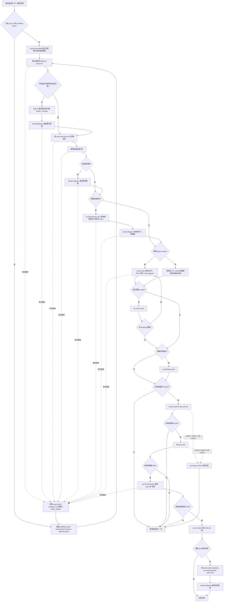

# CP 後端任務總控

協調 CP 後端任務從需求、估時到 MR 的階段流程。實作階段可由 `cp-task-dev` 協助以 TDD 開發與保存進度；總控只負責判斷狀態、呼叫子 skill、保存文件與回報進度。

## 流程圖



## 子 skill 對照

依階段使用既有 skill，不要複製其細節。每個階段先使用主 skill；輔助 skill 只在觸發條件符合時引用，用來補需求釐清、品質閘門、驗證或外部交付。

| 階段 | 主 skill | 可引用的輔助 skill | 觸發條件 | 主要產出 / 動作 |
|---|---|---|---|---|
| 任務模板 | `cp-task-template` | `cp-backend-workflow` | 沒有任務資料夾、禪道任務描述需要建立或更新 | `task-{編號}/`、禪道主／子任務 HTML |
| Repo inventory | `cp-backend-workflow` | `cp-backend-dev-doc` 探索結果 | 沒有 `affected-repos.md`、需求變更、後端設計發現新 repo | `project-doc/affected-repos.md` |
| 任務分級 / 需求釐清 | `cp-backend-workflow` | `grill-me`、`drawio-diagram`、`karpathy-guidelines` | 需求未釐清、任務需分 simple / complex、存在假設或高風險業務行為 | 任務規模判斷、確認結論、待確認問題、業務流程圖 |
| 任務估時 | `cp-backend-workflow` | `grill-me` 結論、`affected-repos.md`、`karpathy-guidelines` | 任務分級與主要範圍完成後；需求變更影響範圍、風險或驗收時 | `project-doc/task-estimation.html` |
| 業務 / 風險 / 測試說明 | `cp-backend-workflow` | `grill-me` 結論、`drawio-diagram`、`karpathy-guidelines` | 分級完成後；complex 任務或會議前需要明確風險與測試範圍 | 業務說明、需求風險與測試說明、上線評估、狀態流轉圖 |
| 後端設計 | `cp-backend-dev-doc` | `karpathy-guidelines`、`drawio-diagram`、`cp-backend-workflow` 校正 repo | 需求需要 API / DB / Redis / 業務流程設計，或既有設計需更新 | backend dev doc HTML／Markdown、資料流與架構圖、校正 `affected-repos.md` |
| TDD 實作 | `cp-task-dev` | `karpathy-guidelines`、必要時 `grill-me` | 使用者要 Agent coding、需要 TDD、需求仍有實作前歧義 | 需求分析、TDD 測試計畫、開發進度與交接紀錄 |
| Review | `cp-code-review` | `karpathy-guidelines`、`cp-task-dev` 測試紀錄 | 使用者要求 review、提測前、MR review、commit 前需要風險確認 | blocking / non-blocking / OK review 結果 |
| 自測 | `cp-self-test-report` | `cp-task-dev` 測試紀錄、`cp-code-review` 結果 | 使用者要求自測報告、任務明確需要後端自測交付 | 後端自測報告（可選） |
| Commit | `commit` | `cp-backend-workflow`、`cp-code-review` | 使用者明確要求 commit，且 repo 範圍與測試 / review 狀態已確認 | 繁中 Conventional Commit |
| Push | `cp-backend-workflow` | 無專用 skill | 使用者明確要求 push，且每個 repo 已 commit | 每個 repo 各自 push |
| MR 描述 | `cp-mr-description` | `affected-repos.md`、`cp-task-dev`、`cp-self-test-report`、`cp-code-review` | 使用者要開 MR 或產 MR 描述，且 repo 範圍已確認 | 每個 repo 一份 MR Markdown |
| MR 提交 | `cp-mr-submit` | Chrome / GitLab 登入狀態、`cp-mr-description` | 使用者確認 MR 描述並要求建立 MR | GitLab MR、Assignee、merge options、MR URL |
| QA 測試矩陣報告 | `cp-backend-workflow` | `cp-task-dev`、`cp-self-test-report`、`cp-mr-description`、`drawio-diagram` | MR 建立後，使用者需要交付 QA 測試範圍 | MR 後 QA 測試矩陣報告、測試路徑圖 |
| 衝突 | `cp-merge-conflict` | `cp-backend-workflow` 暫停後續階段 | merge / rebase / pull 出現 conflict | 衝突分析與合併建議，使用者確認後才寫入 |
| 流程圖 | `drawio-diagram` | `grill-me` 結論、`cp-backend-dev-doc`、`qa-test-matrix.md` | 需求釐清後產業務流程圖；有狀態流轉時產狀態流轉圖；後端設計後產資料流與架構圖；QA 測試矩陣完成後產測試路徑圖；或使用者要求畫圖 / 要貼 Confluence | `project-doc/diagrams/*.drawio`（有 draw.io desktop 時另產 `.png`） |

輔助 skill 調用規則：

- `karpathy-guidelines` 是品質閘門，不是獨立階段；需求釐清、後端設計、TDD、review 都要套用它的假設 / 簡潔 / 精準改動 / 驗證標準。
- `grill-me` 只負責逐題釐清決策，不直接改文件；結論由總控寫入業務、風險、測試或上線文件。
- `cp-task-dev` 的測試紀錄是 review、自測報告、MR 描述與 QA 測試矩陣的主要輸入之一。
- `cp-code-review` 的結果可回饋到 `cp-task-dev` 修正，也可作為 commit / MR 前的風險依據。
- `cp-backend-dev-doc` 完成後必須回饋 `affected-repos.md`，避免後續 review / commit / MR 範圍過期。
- `drawio-diagram` 只畫圖，不決定需求；圖的內容以 `pre-dev-brief.html` 與後端開發文件為準，圖與文字不一致時以文字為準。開發文件內已有 mermaid 時，mermaid 是來源、drawio 是產物，要改流程先改 mermaid 再重產。

## 啟動時收集

取得或確認：

- 禪道／CP 任務編號與任務 URL 或內容。
- 禪道衝刺版號（Scrum sprint version），例如 `1_25_0`。
- 任務文件根目錄 `task_root` 與完整任務目錄 `task_dir`。若使用者未提供，先詢問要放哪裡；可建議預設 `{repo}/task-doc/{衝刺版號}/` 或 `/Users/jixiangwang/Documents/pte-work/gitlab/cp-v2/cp-backend/task-doc/{衝刺版號}/`，但不得未確認就建立。
- 受影響 repo、目前分支與目標分支（預設 `master`）；source branch 依「分支命名」節的 `feature/{衝刺版號}_task-{任務編號}` 格式確認。
- 任務規模：`simple` / `complex`；若不明，先依影響範圍判斷。
- 任務估時是否要貼禪道、是否要拆前端 / 後端 / QA / PM 溝通成本。
- 是否需要跨 PM / 後端 / 前端 / QA 會議討論。
- 是否涉及預發 / 正式共用 DB、Redis、MQ、排程、回調或資料初始化。
- 是否涉及 Web 前後端業務互動流程：頁面入口、角色權限、前端操作、後端 API、DB / Redis 變化、前端回顯 / 錯誤提示。
- 是否要產出自測報告。
- 實作方式：由 `cp-task-dev` 協助 TDD，或由使用者人工 coding。
- 是否要執行 commit、push、產生 MR 描述、提交 GitLab MR。

若已有 `task_dir`，先讀取既有文件與 handoff，不覆蓋既有資料。資訊不足時一次只詢問最必要的問題。

## Workflow State 與續跑

每個任務資料夾固定維護：

- `handoff/workflow-state.md`：目前流程狀態、repo 進度、文件產物、外部操作結果。
- `handoff/requirement-changes.md`：需求變更紀錄與返工判斷。
- `project-doc/affected-repos.md`：本任務受影響 repo 清單，後續 review / commit / push / MR 都以它為準。
- `project-doc/task-estimation.html`：任務估時 HTML 表格。
- `project-doc/pre-dev-brief.html`：開發前主管提報文件，說明需求背景、方案、影響範圍、風險、測試、估時與待決策事項。
- `project-doc/business-brief.html`：complex 任務的詳細業務流程補充附件。
- `project-doc/release-assessment.html`：有上線風險時才產生的預發 / 正式上線評估，特別記錄 DB / Redis 影響。
- `project-doc/diagrams/`：本任務的 draw.io 流程圖與 PNG，由 `drawio-diagram` 產生。
- `end-version-report/qa-test-matrix/qa-test-matrix.md`：MR 建立後的 QA 測試矩陣報告。

啟動時先執行：

1. 若 `workflow-state.md` 存在，先讀取它作為目前流程狀態。
2. 若 `requirement-changes.md` 存在，讀取最新需求版本與未處理變更。
3. 再用實際工作區狀態驗證 repo：`git status`、目前 branch、是否有未提交變更、是否已 push、是否已有 MR。
4. 若狀態檔與 git 現況不一致，以 git 現況為準，並更新 `workflow-state.md`。
5. 已標記 `done` 或 `skipped` 的階段不得重複執行，除非使用者明確要求重跑。
6. 若存在 `needs_update`，優先處理需要更新的階段，不要繼續往後做 MR 或結案。

狀態值只使用：

- `pending`：尚未處理
- `in_progress`：正在處理
- `done`：已完成
- `skipped`：使用者明確跳過
- `blocked`：有阻塞，需使用者或外部狀態處理
- `needs_update`：需求變更後，已完成產物需要更新

每完成一個階段後，更新 `workflow-state.md`：

- repo 狀態：coding、review、commit、push、MR 描述、MR URL。
- 文件狀態：任務描述、任務估時、後端開發文件、自測報告、MR 描述。
- 外部操作結果：commit hash、push 狀態、MR URL。
- 使用者決策：是否跳過自測、是否 commit、是否 push、是否建立 MR。
- 最近進度：用時間條列記錄完成了什麼。

若流程被中斷，下次從第一個 `needs_update`、`blocked` 或 `pending` 階段繼續。

## 需求變更處理

當使用者補充、修改、推翻或擴大需求時，不得直接覆蓋既有文件或狀態。

處理流程：

1. 在 `handoff/requirement-changes.md` 新增一筆需求變更紀錄，版本號依序遞增：`R1`、`R2`、`R3`。
2. 比對變更內容與已完成階段，判斷受影響範圍。
3. 將受影響的 `done` 階段改為 `needs_update`。
4. 未受影響的階段保持 `done`，不得重做。
5. 更新 `workflow-state.md` 的目前需求版本與受影響 repo / 文件狀態。
6. 回報使用者：哪些產物需要更新、哪些可以沿用、是否需要人工 coding。
7. 等使用者確認後，再更新對應文件或進入 coding / review / MR 階段。

影響判斷規則：

- API input / output 變更：後端開發文件、coding、review、自測報告、MR 描述標記 `needs_update`。
- DB schema / Redis 變更：後端開發文件、coding、review、自測報告、MR 描述標記 `needs_update`。
- 業務規則變更：後端開發文件、coding、review、自測報告、MR 描述標記 `needs_update`；`diagrams/` 的 `business-flow` 一併標記。
- API / DB / Redis 變更影響資料流或分層：`diagrams/` 的 `data-flow`、`architecture` 標記 `needs_update`。
- 狀態機、狀態流轉或觸發事件變更：`diagrams/` 的 `state-machine` 標記 `needs_update`。
- 測試範圍、必測路徑或異常路徑變更：`diagrams/` 的 `test-path` 標記 `needs_update`，與 `qa-test-matrix.md` 一起重產。
- 開發文件內的 mermaid 與對應 drawio 一律同時標記 `needs_update`，且先改 mermaid 再重產 drawio。
- 影響 repo 範圍、實作策略、驗收條件、風險或交付時間：任務估時標記 `needs_update`。
- 前後端業務互動流程變更，例如頁面入口、操作步驟、前端 request / response 處理、錯誤提示、角色權限：需求風險與測試說明、自測報告、MR 描述、QA 測試矩陣報告標記 `needs_update`；若影響 API 或前後端實作，再標記後端開發文件與 coding。
- 只改禪道文字描述：任務模板或 MR 描述標記 `needs_update`。
- 只補測試說明：自測報告標記 `needs_update`。
- 會議後調整業務流程、風險或測試範圍：業務說明、需求風險與測試說明標記 `needs_update`；若影響實作，再標記後端開發文件與 coding。
- 上線策略、DB / Redis / 預發正式共用資源評估變更：上線評估、自測報告、MR 描述標記 `needs_update`；若影響程式或資料腳本，再標記 coding。
- MR 建立後又變更需求、測試失敗或調整上線策略：QA 測試矩陣報告標記 `needs_update`，待 MR / 文件重新定案後再重產。
- MR 已建立後才變更需求：不自動重開 MR，只標記 MR 需要更新並等待使用者確認。
- 需求新增或移除服務 / repo：`affected-repos.md` 標記 `needs_update`，並重新判斷 review、commit、push、MR 範圍；`diagrams/` 的 `architecture` 一併標記。

## 任務分級與 grill-me 導入

在 `cp-task-template` 建立任務資料夾、且 `affected-repos.md` 初步完成後，先做任務分級，再決定文件深度。

## Karpathy Guidelines 導入點

`karpathy-guidelines` 不是獨立階段，而是整個 workflow 的品質閘門。總控在呼叫子 skill 前後套用以下檢查：

1. **Think Before Coding**：在 `grill-me`、後端開發文件與 `cp-task-dev` 前，明確列出已確認結論、仍是假設的內容、需要使用者決策的問題；關鍵業務行為、金流 / 訂單 / 權限 / DB 影響不明時，不直接進入 coding。
2. **Simplicity First**：任務分級為 `simple` 時，後端開發文件與 TDD 計畫只保留支撐驗收的最小設計；不得新增泛用框架、未要求的配置化或跨場景抽象。
3. **Surgical Changes**：`affected-repos.md` 是改動邊界；coding、review、commit、MR 只處理狀態不是 `not_required` 的 repo。發現無關重構、格式化或既有死 code，只記錄風險，不順手修改。
4. **Goal-Driven Execution**：每個進入 coding 的 repo 都必須在 `cp-task-dev` 產出可驗證目標與測試命令；沒有實際執行的測試，不得被記錄為通過。

若 runtime 未安裝 `karpathy-guidelines`，總控仍依本節執行同等規則，不阻塞流程。

### 分級規則

符合任一條件時，預設判定為 `complex`：

- 跨 2 個以上 repo，或同時影響前端 / 後端 / QA / PM 流程。
- 需要驗證完整 Web 前後端業務互動流程，包含頁面操作、API、DB / Redis 與前端回顯 / 錯誤提示。
- 涉及 DB schema、Redis、MQ、排程、回調、通知、資料初始化或資料修復。
- 涉及資金、訂單、商戶、交易員、權限、風控或狀態機。
- 需要評估預發 / 正式共用 DB、Redis，或預發作為正式備援的上線影響。
- 需求有多角色、多狀態、多流程分支，或 PM / QA 需要拿文件開會對齊。

不符合上述條件、且是單 repo 小改 / 小 API / 文案 / 查詢欄位時，可判定為 `simple`。

### grill-me 使用時機

- 所有任務在產後端開發文件前，都要先使用 `grill-me` 做需求釐清。
- `simple` 任務：使用輕量 grill，只確認改動範圍、驗收條件、主要風險、測試重點與不做事項；通常 1~3 題即可。
- `complex` 任務：使用完整 grill，逐題確認業務流程、角色影響、DB / Redis / MQ / 排程 / 回調 / 通知、權限 / 風控、測試範圍、上線與回滾。
- 使用者明確說「用 grill-me 分析 / grill 一下需求」：直接啟動，不再重複確認。
- 使用者明確說不用追問：可跳過，但要在 `workflow-state.md` 記錄 `grill_me: skipped` 與原因；此時仍需在需求風險與測試說明中標示未經 grill 確認的假設。

本 workflow repo 自帶 `skills/grill-me/`。若 runtime 尚未安裝該 skill，使用本 repo 的 `skills/grill-me/SKILL.md` 規則執行同等流程，不依賴外部 `grilling` skill。

`grill-me` 只負責逐題釐清決策，不直接改文件；確認結論後，總控再更新需求風險與測試說明；若為 `complex`，再更新業務說明與上線評估。QA 測試矩陣報告是 MR 建立後的收尾產物，不在此階段生成。

## 任務估時

任務估時在任務分級與主要需求釐清後產生，早於後端開發文件與 TDD 實作。估時先用簡單 HTML 表格即可，供禪道貼上、PM 排期與後續需求變更比對。

備註：目前這份估時表是暫時給 CP 後端流程使用；之後再抽象成更通用的估時模型，並依不同系統、環境與交付流程定義不同的估時項目。

產出位置固定：

```text
project-doc/task-estimation.html
```

HTML 表格固定欄位：

```html
<table>
  <thead>
    <tr>
      <th>估時項目</th>
      <th>工作內容</th>
      <th>預估工時</th>
      <th>備註</th>
    </tr>
  </thead>
  <tbody>
    <tr><td>需求整理</td><td></td><td></td><td></td></tr>
    <tr><td>Coding</td><td></td><td></td><td></td></tr>
    <tr><td>自測與修改</td><td></td><td></td><td></td></tr>
    <tr><td>文件整理</td><td></td><td></td><td></td></tr>
    <tr><td>前端對接文件</td><td></td><td></td><td></td></tr>
    <tr><td>Code Review / MR 準備</td><td></td><td></td><td></td></tr>
    <tr><td>部署收尾</td><td></td><td></td><td></td></tr>
    <tr><td>合計</td><td></td><td></td><td></td></tr>
  </tbody>
</table>
```

估時規則：

- `Coding` 包含後端實作與必要單元 / 整合測試補強，不包含自測後返修。
- `自測與修改` 包含本地測試、功能自測、排程 / 回調 / DB 狀態確認與自測後修正。
- `文件整理` 包含後端開發文件、自測報告、MR 描述或禪道需要貼上的後端說明。
- `前端對接文件` 包含 API input / output、錯誤碼、欄位說明、頁面互動注意事項。
- `Code Review / MR 準備` 是總控預設補上的估時項，包含 self-review、處理 review 問題、整理 MR 前置資訊。
- `部署收尾` 包含 push、MR 建立後追蹤、上線注意事項、DB / Redis / 排程 / 回調確認與 QA 交接。
- 需求未確認時，在備註欄標明假設與待確認事項，不要把估時寫成單一確定承諾。
- 需求變更後，只更新受影響的列與合計，保留前一版估時摘要或備註，方便比較增減。

### 分級後產物

`simple` 任務至少維護：

- `project-doc/task-estimation.html`
- `project-doc/pre-dev-brief.html`
- `project-doc/diagrams/{task_id}-business-flow.drawio`

`complex` 任務額外維護：

- `project-doc/business-brief.html`
- `project-doc/diagrams/{task_id}-data-flow.drawio`
- `project-doc/diagrams/{task_id}-architecture.drawio`

涉及訂單、工單、審核或任何狀態機時，額外維護：

- `project-doc/diagrams/{task_id}-state-machine.drawio`

所有任務在 MR 建立後，若使用者需要交付 QA，才產生：

- `end-version-report/qa-test-matrix/qa-test-matrix.md`

涉及 DB、Redis、MQ、排程、回調、正式資料修復、預發正式差異或需要明確上線 / 回滾計畫時，額外維護：

- `project-doc/release-assessment.html`

會議前置文件直接產 HTML；HTML 內容要能直接貼入禪道富文本。

### 會議前置文件內容

`pre-dev-brief.html` 是 simple / complex 都要有的開發前主管提報主文件，內容先固定包含：

- 需求背景：為什麼要做，現況痛點是什麼。
- 目標方案：這次要怎麼解，預期流程會變成什麼。
- 影響範圍：影響哪些服務、API、DB、Redis、MQ、排程、回調、前端頁面或外部系統；不確定項標 `待確認`。
- 業務流程：用條列或流程圖說明主要流程、狀態流轉與前後端互動；附上 `diagrams/` 下對應的 `.drawio` 檔名，有 PNG 時一併引用。
- 風險與注意事項：整理金流、訂單狀態、權限、幣種、回調、排程、資料一致性、相容性與前後端顯示落差等風險。
- 測試與驗收重點：列出後端自測、前後端聯調、QA 必測路徑、異常路徑與回歸範圍。
- 開發估時：引用 `task-estimation.html` 的估時摘要。
- 待主管 / PM / QA 確認事項：列出需要會上確認的決策。
- 不做範圍：明確列出本次不處理的功能、資料修復、相容場景或前端改動。

`business-brief.html` 只在 complex 任務產生，作為 `pre-dev-brief.html` 的詳細業務流程附件：

- 現況流程與痛點。
- 目標流程與角色分工。
- 主要狀態流轉、資料流與前後端互動；有狀態機時附上 `diagrams/{task_id}-state-machine.drawio`，節點是狀態、邊是觸發事件。
- 邊界案例與例外處理。
- 會議決策紀錄。

`release-assessment.html` 只在 complex 或涉及上線風險時產生，內容聚焦上線影響：

- 預發 / 正式環境差異。
- DB / Redis / MQ / 排程 / 回調 / 初始化資料影響。
- 上線步驟、驗證方式與回滾方式。
- 是否需要停機、灰度、補資料或通知 QA / PM / 運維。
- 上線後觀察指標與已知殘留風險。

## QA 測試矩陣報告

QA 測試矩陣報告是 MR 建立後的收尾產物，不是開發前輸入文件。

產生前必須確認：

- `affected-repos.md` 中需要處理的 repo 已建立 MR，狀態為 `mr_created`。
- 不存在 `needs_update`、`blocked`、`needs_confirm` 的必要 repo。
- MR 描述、自測報告、需求風險與測試說明、上線評估都是最新狀態。

若任一條件不成立，不產生正式 QA 測試矩陣報告；先回報缺少哪個前置階段。

產出位置固定：

```text
end-version-report/qa-test-matrix/qa-test-matrix.md
```

內容來源：

- 最終 MR URL、repo、branch。
- `project-doc/pre-dev-brief.html` 的風險與測試說明。
- `test-file-script/` 下已完成的自測結果。
- `project-doc/release-assessment.html` 的預發 / 正式 / DB / Redis 評估。
- 實際 code diff 與 MR 描述。

QA 測試矩陣必須額外整理 Web 前後端業務互動測試流程：

- 使用者角色與權限。
- 前端頁面入口、操作步驟、欄位輸入與按鈕行為。
- 前端送出的 API request 與後端 response / 錯誤碼。
- 後端 DB / Redis / MQ / 排程等副作用。
- 前端成功回顯、錯誤提示、列表刷新、狀態變更或導出結果。
- 無法由 Agent 實測的頁面互動，要列為 QA / 開發者需補測與補截圖項目。

矩陣寫完後，用 `drawio-diagram` 產 `diagrams/{task_id}-test-path.drawio`：lane 分「正常路徑」與「異常路徑」，把矩陣裡的必測路徑畫成流程，異常分支用紅色節點。這張圖是給 QA 看的交接圖，內容必須與 `qa-test-matrix.md` 一致；矩陣改了要一併重產。

## Repo Inventory

總控必須維護 `project-doc/affected-repos.md` 作為任務 repo 名冊。後續 review、commit、push、MR 描述與 MR 提交都以這份清單為準，不要每個子 skill 重新猜 repo 範圍。

建立或更新時機：

1. `cp-task-template` 建立任務資料夾後：根據任務描述初始化可能受影響 repo。
2. `cp-backend-dev-doc` 完成後：根據 codebase 探索結果校正 repo 清單。
3. 需求變更後：重新評估新增、移除或不再需要處理的 repo。
4. 使用者明確補充「還有另一個服務 / 前端 repo 要改」時：追加或更新清單。

格式固定：

```markdown
# task-{編號} affected repos

| repo | 類型 | 路徑 | source branch | target branch | 狀態 | 備註 |
|---|---|---|---|---|---|---|
|  | backend / backend-base / backend-open / frontend / other |  | feature/{衝刺版號}_task-{任務編號} | master | needs_confirm |  |
```

source branch 一律填「分支命名」節的格式；尚未開分支時照樣先填預期名稱，並在備註標 `未建立`。

Repo 狀態只使用：

- `needs_confirm`：可能受影響，需使用者或 codebase 探索確認。
- `pending`：已確認需要處理，但尚未 coding。
- `coding_done`：coding 已完成，尚未 review / commit。
- `reviewed`：已 review。
- `committed`：已 commit。
- `pushed`：已 push，可產 MR。
- `mr_ready`：MR 描述已產生。
- `mr_created`：MR 已建立。
- `not_required`：已確認相關但不需要處理。
- `blocked`：該 repo 有阻塞。
- `needs_update`：需求變更後需要重新處理。

規則：

- 不確定是否受影響的 repo，不要刪掉，標記 `needs_confirm`。
- 明確不需要改但與任務相關的 repo，保留並標記 `not_required`，避免後續重複詢問。
- 多 repo 任務的每個 repo 必須各自有一列，不得合併。
- `workflow-state.md` 的 Repo 狀態要與 `affected-repos.md` 同步；若兩者不一致，以 `affected-repos.md` 作為任務範圍，以 git 現況作為實際進度。
- 後續 review / commit / push / MR 只處理狀態不是 `not_required` 的 repo；`needs_confirm` 必須先確認，不可直接提交或建立 MR。

## 分支命名

開發者常同時跑多個任務，分支名稱必須一眼看出「哪個衝刺、哪個任務」。

格式固定：

```text
feature/{衝刺版號}_task-{任務編號}
```

範例：

```text
feature/1_25_0_task-5987
```

- `{衝刺版號}` 是禪道 Scrum sprint version，例如 `1_25_0`，不是程式發版版本。
- `{任務編號}` 是禪道任務編號，與 `task_dir` 的 `task-{編號}` 一致。
- 修 bug 類任務可用 `fix/` 取代 `feature/`，其餘格式不變。
- 多 repo 任務的每個 repo 都用**同一個分支名稱**，方便對照與開 MR。

進入 coding 前必須檢查：

1. 讀 `affected-repos.md`，取得每個要處理 repo 的 source branch。
2. 對每個 repo 執行 `git branch --show-current`，比對是否符合上述格式。
3. **不符合或還在 `master` / `develop` 上時，提醒使用者**：目前在哪個分支、依任務資訊建議的分支名稱是什麼、有哪些 repo 需要開分支。
4. 缺少衝刺版號時先問使用者，不要自己編一個版號。

**建立或切換分支屬於外部操作，必須使用者明確要求才執行**；總控預設只提醒與提供建議指令，不自行 `git checkout -b`。

分支名稱確認後寫回 `affected-repos.md` 的 source branch 欄，後續 commit、push、MR 都以它為準。

## 階段判斷

依序檢查工作區與文件狀態：

1. 沒有任務資料夾：使用 `cp-task-template` 建立標準骨架與任務文件。
2. 沒有 `project-doc/affected-repos.md` 或其狀態為 `needs_update`：建立或更新 repo inventory。
3. 尚未任務分級或文件缺失：判斷 `simple` / `complex`；使用 `grill-me` 釐清後，simple 產需求風險與測試說明，complex 另產業務說明與上線評估。需求釐清完成後，用 `drawio-diagram` 產 `business-flow` 業務流程圖，供會議與 `pre-dev-brief.html` 引用；任務涉及狀態機時另產 `state-machine`，附在 `business-brief.html`。
4. 沒有 `project-doc/task-estimation.html` 或其狀態為 `needs_update`：依任務分級、repo 範圍、風險與待確認事項產生或更新估時 HTML 表格。
5. 沒有後端開發文件且需求需要設計：使用 `cp-backend-dev-doc`；完成後校正 `affected-repos.md`，並用 `drawio-diagram` 產 `data-flow` 與 `architecture`。
6. 進入 coding 前：依「分支命名」節檢查每個要處理 repo 的目前分支；不符 `feature/{衝刺版號}_task-{任務編號}` 或仍在 `master` 上時，先提醒使用者並給建議分支名稱，等使用者確認或自行開分支後再往下。
7. 仍未 coding：若使用者希望 Agent 協助實作，使用 `cp-task-dev` 先完成需求分析與 TDD 計畫，再進入實作；若由使用者人工 coding，仍要求以同一組文件記錄測試與進度，不假設程式已修改。
8. 有未提交程式變更：先確認 `cp-task-dev` 的 `dev-progress.md` 與測試紀錄已更新，再依 `affected-repos.md` 範圍執行 `cp-code-review`（使用者要求時），再用 `commit`；保留不相關變更，不自動加入。
9. 分支未 push：依 `affected-repos.md` 範圍在使用者明確要求時執行 push；網路受限時申請授權，不重複執行已成功的 push。
10. 自測報告：只有使用者要求或任務明確要求時使用 `cp-self-test-report`；使用者說「不用自測／不寫自測報告」時跳過，並在後續 MR 描述標記為不產出。
11. 要開 MR：依 `affected-repos.md` 範圍先使用 `cp-mr-description` 產生每個 repo 的 Markdown，再由使用者確認內容後使用 `cp-mr-submit` 實際建立 MR。
12. MR 建立完成後：若需要交付 QA，依最終 MR、需求風險與測試說明、自測報告、上線評估產生 `end-version-report/qa-test-matrix/qa-test-matrix.md`，再用 `drawio-diagram` 產 `test-path` 測試路徑圖。
13. 發生 merge conflict：停止後續提交，使用 `cp-merge-conflict` 分析，等待使用者確認合併方案。

## 多 repo 任務規則

- 每個 repo 都是獨立 Git root，分別檢查 branch、status、commit、push 與 MR。
- 每個 repo 用同一個 `feature/{衝刺版號}_task-{任務編號}` 分支名稱，不要各 repo 取不同名字。
- 不把不同 repo 的變更混在同一次 commit 或 MR。
- 任務文件一律放在已確認的 `task_dir` 之下；預設格式可以是 `{task_root}/task-{編號}/...`，但 `task_root` 必須先確認。這裡的衝刺版號是禪道 Scrum sprint version，不是程式發版版本。
- MR 文件放在：`{task_dir}/end-version-report/mr-description/mr-description-{服務名}.md`。
- MR 建立設定依 `cp-mr-submit`：Assignee 預設 `austin`、Reviewer 不設定、Delete source branch 關閉、Squash commits 開啟。
- 已存在 MR 時不得重複建立；只回報現有 MR，除非使用者要求更新。

## 呼叫子 skill 時的路徑契約

總控呼叫任何會讀寫任務文件的子 skill 時，必須明確提供：

- `task_id`：任務編號，例如 `task-5987`。
- `sprint_version`：禪道衝刺版號，例如 `1_25_0`。
- `task_root`：已確認的任務文件根目錄，例如 `task-doc/1_25_0` 或其他使用者指定路徑。
- `task_dir`：完整任務資料夾，例如 `{task_root}/task-5987`。

呼叫 `drawio-diagram` 時另外傳：

- `output_dir`：`{task_dir}/project-doc/diagrams/`
- `prefix`：`task-{編號}`

子 skill 收到 `task_dir` 時，必須優先使用該路徑讀寫文件，不得自行退回舊路徑 `task-doc/task-{編號}` 或任何寫死的絕對路徑。若缺少 `task_dir`，先向使用者確認 `task_root`，再組出 `task_dir`。

## 外部操作確認

以下動作會改變外部狀態，只有使用者明確要求時執行：

- `git commit`
- `git push`
- 建立 GitLab MR
- 設定 Assignee、Approval Rule 或 merge options

若使用者只要求分析、產文件或產生指令，不要自行 commit、push 或建立 MR。

## 進度回報

每個階段完成後回報：

- 已完成的 repo 與階段。
- 尚未完成或被阻擋的 repo 與原因。
- 產出的文件路徑、commit hash、branch 或 MR URL。
- 不要把「已產生 MR 描述」誤報成「已建立 MR」。

MR 完成後依 `cp-mr-submit` 的固定格式輸出：

```markdown
## task-{編號}
### {服務名稱}
{MR URL}
```
